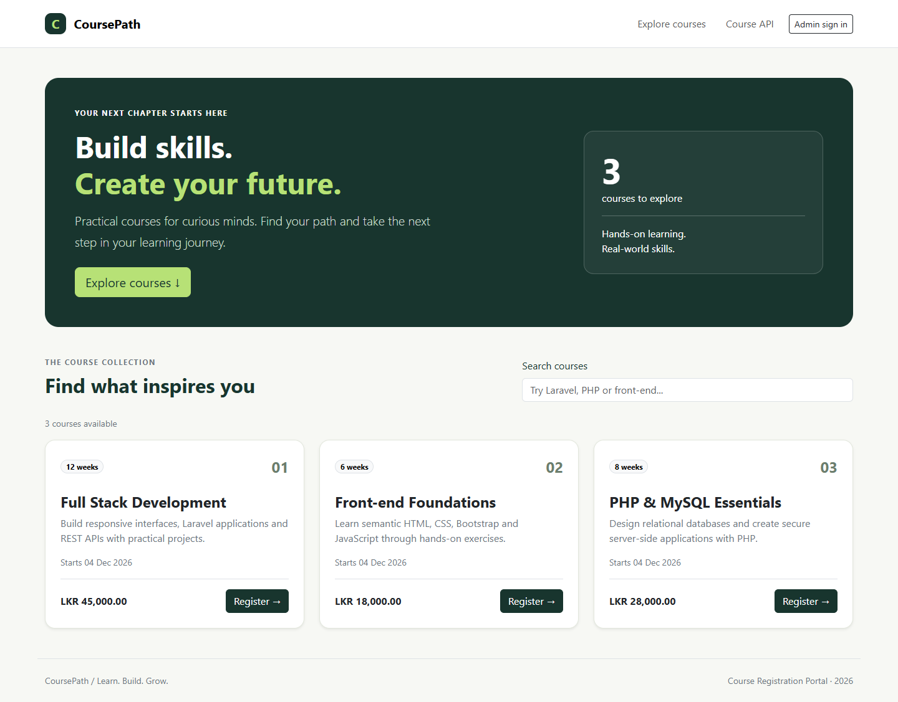
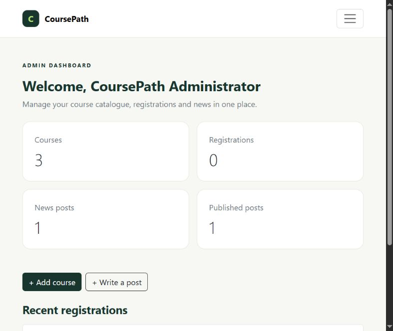

# CoursePath Course Registration Portal

A Laravel and MySQL application for browsing courses, registering students, managing the course catalogue, and publishing news. The responsive frontend uses Blade, Bootstrap 5 and JavaScript.

## Features

- Administrator sign-in and dashboard.
- Add, view, edit and delete courses with server-side validation and deletion confirmation.
- Visitor registration with name, email and phone number.
- Duplicate registration prevention using a composite database constraint on course and email.
- Responsive navigation, course cards and live course search.
- Public `GET /api/courses` endpoint returning courses as JSON.
- News management with drafts, publishing, editing and deletion.
- Laravel migrations, SQL schema, automated tests and Docker deployment configuration.
- VS Code workspace and startup task for the configured local installation.

## Preview





## Requirements

- PHP 8.4.1 or newer for the supplied lockfile; PHP 8.5 is recommended.
- Composer 2 and the PHP extensions listed in [the application guide](portal/README.md).
- MySQL 8.4. The local application was verified on MySQL Community Server 8.4.13.

Frontend assets are bundled locally. No Node build is needed for the Laravel portal. The separate React/Express exercise has its own dependencies.

## Install and run

```text
git clone https://github.com/Fayas612/-Course-Registration-Portal.git CoursePath
cd CoursePath/portal
composer install
```

Copy `.env.example` to `.env` and create an empty MySQL database:

```sql
CREATE DATABASE course_portal CHARACTER SET utf8mb4 COLLATE utf8mb4_unicode_ci;
```

Enter your database host, port, name, username and password in `.env`, then run:

```text
php artisan key:generate
php artisan migrate --seed
php artisan portal:admin
php artisan serve --host=127.0.0.1 --port=8000
```

The administrator command asks for your name, email and password. No default administrator password is included. Keep MySQL running while using the portal.

| Page | Local address |
| --- | --- |
| Course catalogue | http://127.0.0.1:8000 |
| News | http://127.0.0.1:8000/news |
| Admin sign-in | http://127.0.0.1:8000/login |
| Admin dashboard | http://127.0.0.1:8000/admin |
| Course API | http://127.0.0.1:8000/api/courses |

These are local development addresses, not a public hosted website.

### VS Code

Open `CoursePath.code-workspace`. On the original configured Windows installation, press **Ctrl+Shift+B** to run **Start CoursePath**, which starts PHP and the project-local MySQL runtime when needed.

A fresh clone excludes that private runtime, `.env` and Composer dependencies. Complete the installation above and configure your own MySQL server first. See [the local run guide](docs/LOCAL_RUN.md). Live Server alone cannot run a Laravel backend.

## Tests

From `portal/`, run `php artisan test`.

The suite passed **19 tests with 168 assertions** on SQLite and MySQL 8.4.13. Local tests use SQLite in memory by default. The GitHub Actions workflow is configured for MySQL 8.4. See [verification details](docs/VERIFICATION.md). Use a dedicated test database because the suite refreshes its test schema.

## Project structure

| Directory | Contents |
| --- | --- |
| `portal/` | Laravel application, frontend views/assets, controllers, models and tests |
| `portal/database/migrations/` | Database migrations for courses, registrations, users and news |
| `portal/database/schema.sql` | Supplementary schema-only export |
| `docs/` | Database design, setup, requirements, deployment and demo guides |
| `.github/workflows/` | MySQL continuous integration workflow |
| `practicals/` | Independent HTML, JavaScript, PHP, Laravel and React/Express exercises |
| `output/` | PDF, Word and Markdown assessment reference answers |

## Deployment status

Source repository: [Fayas612 Course Registration Portal](https://github.com/Fayas612/-Course-Registration-Portal).

A public application URL has not been deployed yet. GitHub Pages does not execute this Laravel/PHP backend; use Laravel-compatible hosting with MySQL. The project includes a Dockerfile, Apache startup script and Railway configuration. See [the deployment guide](docs/DEPLOYMENT.md); use `portal/` as the hosting service's application root. The container configuration is prepared; a successful hosted deployment is not claimed.

## Private configuration

Local `.env` files, administrator credentials, live database files, logs, installed dependencies and the private MySQL runtime are excluded from Git. Create your own accounts and configuration after cloning.

## Assessment reference material

The answer scripts and practical examples are reference and practice material. The supplied assessment states that Sections A-C are closed book and AI tools are prohibited during its Section D lab. Review the course rules and be prepared to explain your own work. Candidate details, the live demonstration and viva remain the candidate's responsibility.
